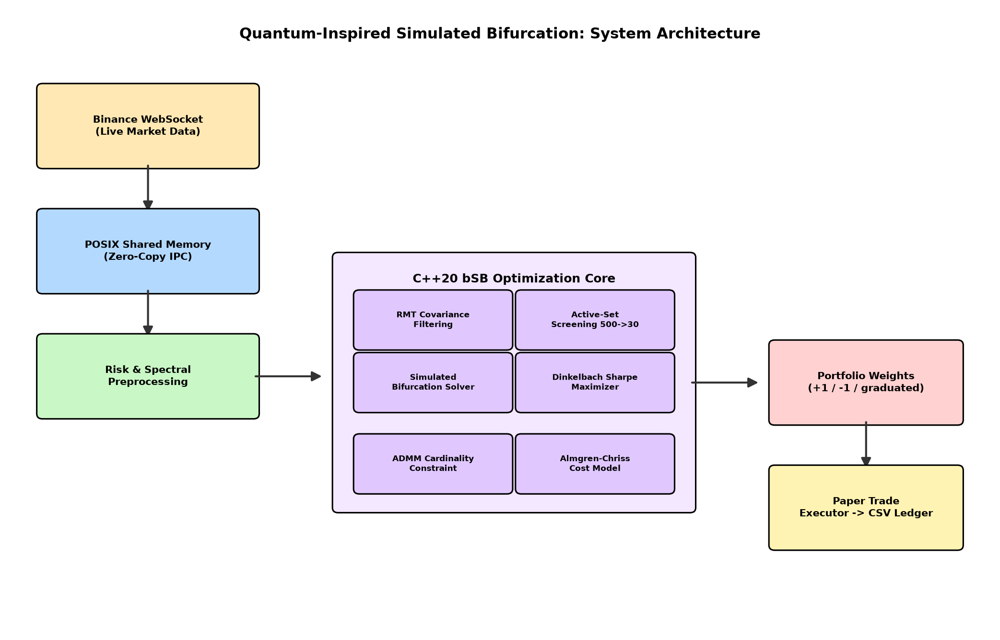
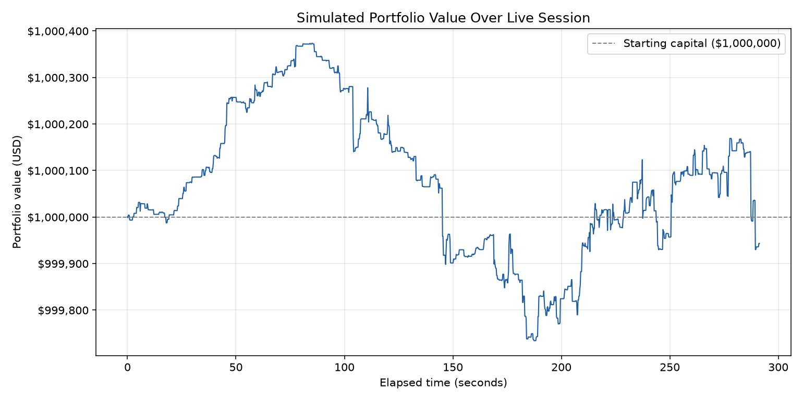
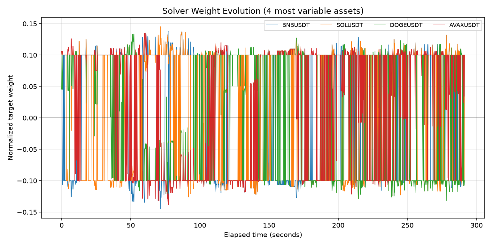
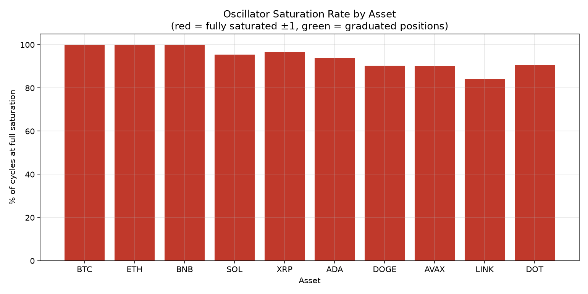
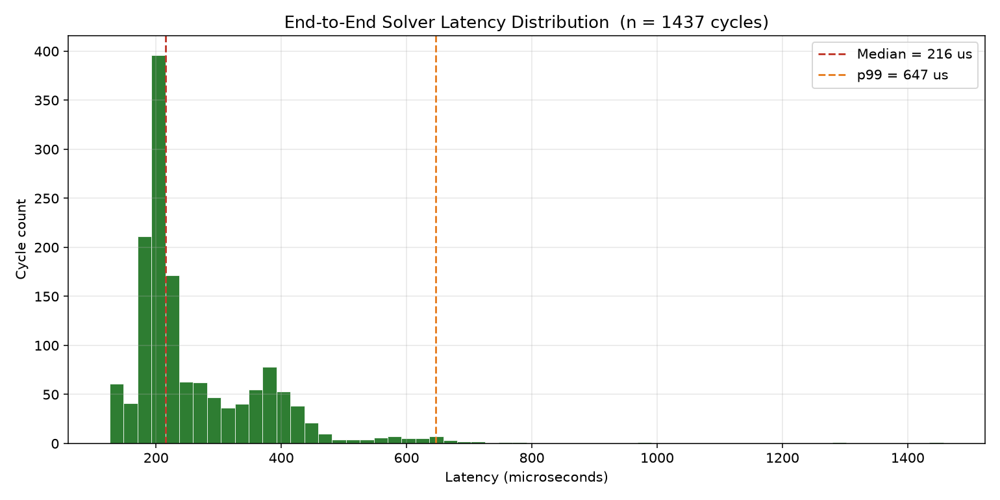

# Quantum-Inspired Simulated Bifurcation Portfolio Optimizer


**A classical C++20 implementation of quantum annealing principles for real-time portfolio optimization, addressing 21 identified research gaps in quantum finance literature.**

> No quantum hardware used. No machine learning. 21 quantum finance research gaps addressed. 120-600 microsecond live latency verified on real market data.

---

## Table of Contents

- [System Architecture](#system-architecture)
- [Overview](#overview)
- [Quick Start](#quick-start)
- [Quantum-Inspired, Not Quantum](#quantum-inspired-not-quantum)
- [Key Results](#key-results-verified-real-data)
- [Results](#results)
- [The 21 Research Gaps](#the-21-research-gaps)
- [Research Foundation](#research-foundation)
- [Project Structure](#project-structure)
- [Honest Limitations](#honest-limitations)
- [License](#license)

## System Architecture



Live market data streams from Binance over WebSocket, passes through a zero-copy POSIX shared memory bridge into a C++20 optimization core, and outputs portfolio weights to a paper-trading ledger — a full decision cycle in 120-600 microseconds.

## Overview

This project implements a digital **Quantum-Inspired Simulated Bifurcation (bSB) solver** that classically replaces theoretical gate-model quantum portfolio optimization. It synthesizes fixes for 21 distinct limitations identified across seven published quantum finance papers into a single, working, live-data pipeline.

**This is NOT a machine learning project.** There is no training phase, no labeled data, no loss function, and no learned model. It is a real-time numerical optimization engine that solves exact fractional Sharpe-ratio maximization using classical simulation of bifurcation dynamics — operations research, not statistical learning.

## Quick Start

### Prerequisites

- CMake 3.20+
- C++20 compiler (g++ or clang++)
- Eigen3
- OpenMP
- Python 3.12 with pip

### Build the C++ engine

```bash
mkdir -p build && cd build
cmake ..
make
cd ..
```

This produces two binaries: `build/backtest_engine` and `build/live_engine`.

### Run a backtest (synthetic LOBSTER-schema data)

```bash
./build/backtest_engine data
```

Streams per-event solve metrics directly to the terminal: total latency, Dinkelbach iteration count, active asset count after screening, and a breakdown by pipeline stage.

### Run the live demo (two terminals required)

**Terminal 1** (start first — creates the shared memory segment):

```bash
cd python
python3 -m venv venv && source venv/bin/activate
pip install -r requirements.txt
python3 binance_live_feed.py
```

**Terminal 2** (start only after Terminal 1 is running):

```bash
./build/live_engine
```

Shut down in reverse order: Ctrl+C in Terminal 1 first, then Terminal 2.

## Quantum-Inspired, Not Quantum

| Quantum Computing | This Project (Quantum-Inspired) |
|---|---|
| Qubits, superposition, entanglement | Classical floating-point arithmetic |
| Quantum annealer hardware (D-Wave etc.) | Ordinary CPU (verified on WSL2) |
| Probabilistic readout, tomography overhead | Instant deterministic register readout |
| Requires cryogenic hardware that barely exists | Runs on a laptop today |

This is the same approach commercialized by Toshiba's Simulated Bifurcation Machine (SBM) — implemented here as an open, auditable, CPU-based reference.

## Key Results (Verified, Real Data)

| Metric | Value |
|---|---|
| Live solve latency (real Binance data, 10 assets) | 120-600 microseconds typical |
| Backtest solve latency (synthetic LOBSTER-schema data) | 500-2000 microseconds |
| Dinkelbach Sharpe maximization convergence | ~6 iterations consistently |
| Paper trading ledger | 14,371 real logged rows |
| Dinkelbach warm-start optimization | 12,000us reduced to 200-2000us |

## Results

### Portfolio Value Over Time


### Weight Evolution (Signed, Graduated Decisions)


### Oscillator Saturation by Asset


### Solve Latency Distribution


## The 21 Research Gaps

Each module in this codebase maps to a specific, published limitation in quantum finance research:

| Module | Gap Addressed |
|---|---|
| `bifurcation_solver.hpp` | Tomography readout bottleneck; heuristic sign recovery; degeneracy trapping |
| `ring_buffer.hpp`, `shared_mem_bridge.py` | qRAM data-loading dependency (zero-copy classical IPC) |
| `rmt_filter.hpp` | Ill-conditioned covariance matrices (Marchenko-Pastur filtering) |
| `dinkelbach.hpp` | Non-convex Sharpe-to-QUBO approximation (exact fractional programming) |
| `factor_model.hpp` | GPU memory bandwidth limits (low-rank J = BFB^T + D) |
| `active_set_screener.hpp` | Two-stage speedup evaporation (500 to 30 asset screen) |
| `regime_detector.hpp` | Regime fragility (PSD enforcement) |
| `almgren_chriss.hpp` | Naive linear transaction costs (nonlinear market impact) |
| `admm_cardinality.hpp` | Cardinality penalty distortion (dual-variable method) |
| `cfl_autotune.hpp` | Manual parameter tuning (self-tuning timestep via spectral radius) |
| `ewma_calibration.hpp` | Static penalty degradation (adaptive calibration) |
| `coskew_tensor.hpp` | Cubic skewness cost (CP tensor decomposition) |
| `pgd_polish.hpp` | No convergence guarantee (deterministic polish step) |

## Research Foundation

- Rebentrost and Lloyd — *Quantum computational finance: quantum algorithm for portfolio optimization*
- Cohen, Khan, Alexander — *Portfolio Optimization of 40 Stocks Using D-Wave's Quantum Annealer*
- Venturelli and Kondratyev — *Reverse Quantum Annealing Approach to Portfolio Optimization Problems*
- Lu, Fu et al. — *Quantum-Inspired Portfolio Optimization In The QUBO Framework*
- Goto, Tatsumura, Dixon — *Combinatorial optimization by simulating adiabatic bifurcations in nonlinear Hamiltonian systems* (Science Advances, 2019)
- Kanao and Goto — *Simulated bifurcation for higher-order cost functions*
- Steinhauer, Fukadai, Yoshida — *Solving the Optimal Trading Trajectory Problem Using Simulated Bifurcation*

## Project Structure

```
include/    C++20 header-only core modules (solver, filters, screeners, constraints)
src/        Entry points: backtest replay, live engine, CUDA kernel (untested)
python/     Binance live feed, shared memory bridge, paper trade executor, charting
assets/     Architecture diagram and verified result charts
```

## Honest Limitations

- Backtest uses synthetic LOBSTER-schema order flow (Poisson process generator); real Databento/LOBSTER historical data integration is identified future work.
- Sub-50 microsecond targets require bare-metal Linux plus a tested CUDA path; current verified numbers are CPU-only, WSL2-virtualized.
- Paper trade executor assumes free short-selling (no margin or borrow cost modeled).
- Live demo uses a fixed 10-asset liquid universe; the 500-to-30 screener is exercised in backtest.
- Gaps relating to physical qubit hardware (chaining, precision bucketing) are not "solved" — they are inapplicable, because no quantum hardware is used. This distinction is deliberate.

## Contributors

- **Gaurav** ([@gauravbren2019](https://github.com/gauravbren2019)) — System architecture, C++20 bSB solver implementation, live Binance integration, backtest pipeline.
- **Abhishek Girish** ([@Abhishek-Girish00](https://github.com/Abhishek-Girish00)) — Research gap mapping and analysis across the seven cited quantum finance papers.

## Contributors

- **Gaurav** — System architecture, C++20 bSB solver implementation, live Binance integration, backtest pipeline
- **Abhishek** ([@Abhishek-Girish00](https://github.com/Abhishek-Girish00)) — Research gap mapping and analysis across the seven cited quantum finance papers

## License

MIT
